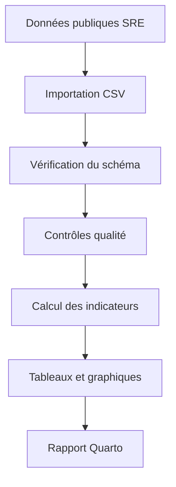
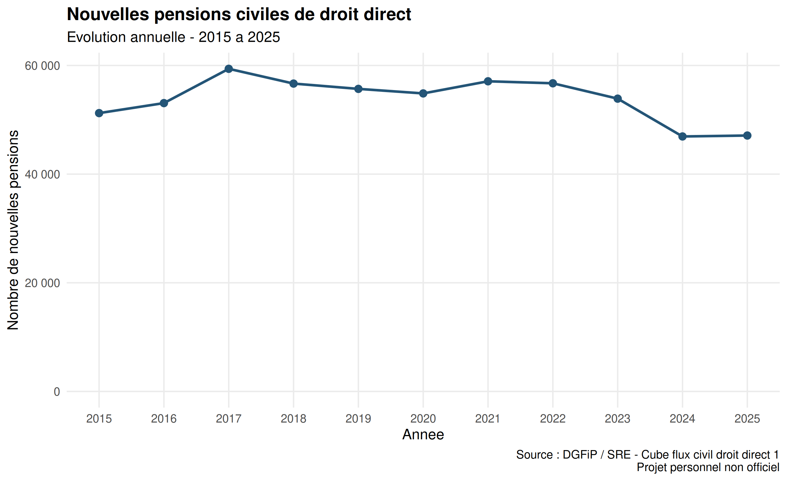
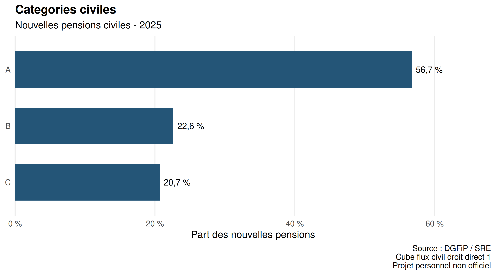
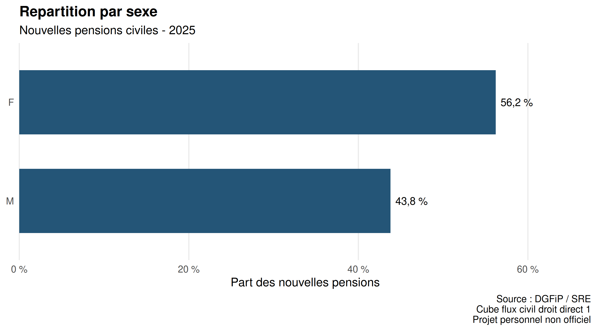
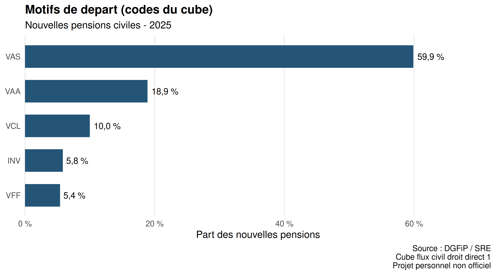
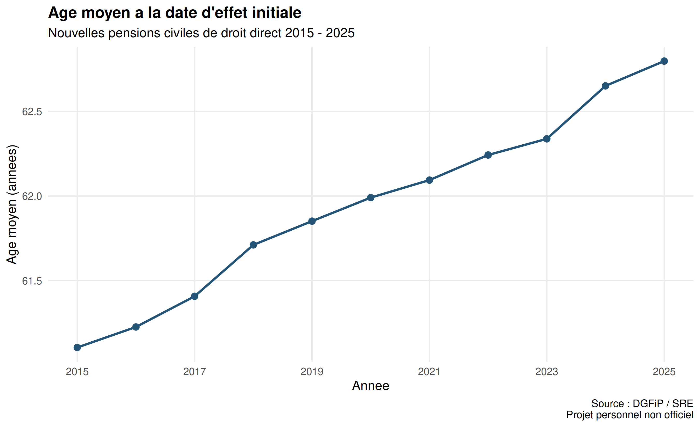
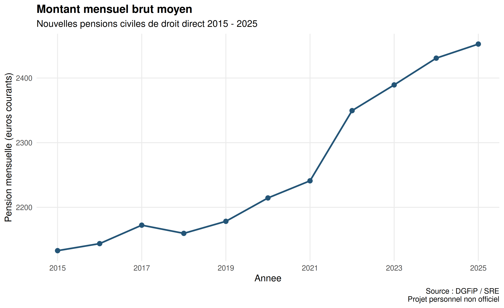

# SRE Data Quality & Statistical Reporting

**Audit, contrôle qualité et production automatisée de statistiques sur les pensions civiles de l'État avec R.**

Projet personnel et non officiel, réalisé à partir de données publiques de la DGFiP / Service des retraites de l'État (SRE).

## Objectif

Construire une chaîne statistique reproductible permettant de :

- importer et conserver les données officielles ;
- vérifier leur structure et leur cohérence ;
- détecter et documenter les anomalies ;
- produire des indicateurs statistiques fiables ;
- automatiser la création de tableaux et graphiques ;
- générer un rapport institutionnel avec Quarto.

Le projet illustre des méthodes de contrôle et d'exploitation de données agrégées applicables à la statistique publique.

## Source des données

**Dataset :** Retraite — Cube flux civil droit direct 1

**Producteur :** DGFiP / Service des retraites de l'État

**Portail :** [data.economie.gouv.fr](https://data.economie.gouv.fr/explore/dataset/cube-flux-civil-droit-direct-1/)

**Période du fichier analysé :** 2015–2025

Le fichier exploité comprend 330 lignes et 11 variables.

Les observations représentent des cellules statistiques agrégées selon l'année, la catégorie civile, le motif de départ et le sexe.

Il s'agit d'un flux de nouvelles pensions et non d'un stock de pensions en paiement.

La licence exacte du jeu de données et ses conditions de réutilisation doivent être reprises des métadonnées du portail avant publication définitive.

## Méthodologie



Les données sources sont conservées séparément des données traitées et des résultats.

Le pipeline interrompt la production en présence d'une anomalie bloquante identifiée par le module actuel.

Aucune correction automatique des données sources n'est effectuée.

## Contrôles qualité

La première version opérationnelle comprend notamment :

- les vérifications de complétude ;
- la détection des effectifs négatifs ;
- la détection des effectifs non entiers ;
- le contrôle des effectifs nuls ;
- le contrôle des effectifs d'assurance ;
- la journalisation des anomalies ;
- la réconciliation des agrégations annuelles.

Des contrôles du schéma, des modalités et de l'unicité ont également été réalisés lors de l'exploration.

**Résultat du module automatisé sur les effectifs :** aucun signalement dans le fichier étudié.

Ce résultat concerne les règles effectivement exécutées. Il ne constitue pas une certification exhaustive de la qualité des données.

Les tests synthétiques permettent de vérifier que le programme détecte des anomalies introduites volontairement dans des données de test distinctes de la source officielle.

## Indicateurs statistiques

Le pipeline produit :

1. Les effectifs annuels de nouvelles pensions.
2. Les variations annuelles absolues et relatives.
3. Les répartitions par catégorie civile.
4. Les répartitions par sexe.
5. Les répartitions par motif de départ.
6. L'âge moyen annuel.
7. Le montant mensuel brut moyen des pensions.

Les moyennes sont calculées à partir des sommes agrégées et des dénominateurs appropriés.

Une simple moyenne des moyennes de sous-groupes n'est pas utilisée.

## Résultats observés

Sur le fichier analysé, pour l'année 2025 :

| Indicateur | Résultat |
|---|---:|
| Nouvelles pensions | 47 104 |
| Variation annuelle | +0,37 % |
| Âge moyen calculé | 62,80 ans |
| Pension mensuelle brute moyenne | 2 452,51 € |
| Part de la catégorie A | 56,7 % |
| Part des femmes | 56,2 % |

Ces valeurs sont issues de l'exécution des scripts R sur le fichier étudié.

Les montants sont exprimés en euros courants, sans correction de l'inflation.

Les évolutions observées sont descriptives et ne démontrent aucune causalité.

## Visualisations

Le projet génère six graphiques avec ggplot2.

### Évolution du nombre de pensions



### Répartition par catégorie



### Répartition par sexe



### Répartition par motif de départ



### Évolution de l'âge moyen



### Évolution de la pension moyenne



## Rapport statistique

Le rapport Quarto rassemble :

- une synthèse exécutive ;
- la présentation des données ;
- la méthodologie ;
- le bilan des contrôles ;
- les tableaux et graphiques ;
- une note statistique destinée à un responsable ;
- les limites méthodologiques ;
- les sources officielles.

Fichier source :

`reports/analyse_pensions.qmd`

Rapport généré :

`reports/analyse_pensions.html`

## Reproduction

### Prérequis

- R
- Quarto
- Les packages R nécessaires
- Le fichier CSV officiel

Le projet a été exécuté dans Posit Cloud avec R 4.6.2.

### Installation provisoire des dépendances

Dans R :

```r
install.packages(c(
  "yaml",
  "jsonlite",
  "readr",
  "ggplot2",
  "testthat",
  "knitr",
  "rmarkdown"
))
```

La gestion reproductible des dépendances avec `renv` reste à finaliser.

### Acquisition des données

Télécharger le fichier depuis le portail officiel, puis le placer dans `data/raw/`.

Le pipeline utilise automatiquement le CSV si un seul fichier correspond au nom attendu.

Si plusieurs copies existent, préciser explicitement le fichier à utiliser :

```r
Sys.setenv(
  SRE_CUBE_FILE = "data/raw/nom_du_fichier.csv"
)
```

### Lancer le pipeline

Depuis la racine du projet :

```r
source("scripts/run_pipeline.R")
```

Cette commande exécute les contrôles, les tests, les calculs, les graphiques et le rendu Quarto.

### Lancer les tests

```r
testthat::test_file(
  "tests/testthat/test-quality-checks.R"
)

testthat::test_file(
  "tests/testthat/test-compute-means.R"
)
```

### Générer uniquement le rapport

```r
system2(
  "quarto",
  c("render", "reports/analyse_pensions.qmd")
)
```

## Validation du pipeline

Dernière exécution documentée : 7 novembre 2026.

Résultats :

- 330 lignes et 11 variables importées ;
- 6 assertions de contrôle qualité réussies ;
- 5 assertions de calcul statistique réussies ;
- indicateurs annuels réconciliés ;
- 6 graphiques vérifiés ;
- rapport HTML généré ;
- statut final du pipeline : SUCCES.

Ces résultats ne couvrent pas encore tous les scénarios de validation envisagés.

## Limites

- Analyse sur données agrégées uniquement.
- Absence de données individuelles.
- Montants exprimés en euros courants.
- Absence d'analyse causale.
- Contrôles qualité automatisés encore partiels.
- Nomenclatures à compléter dans le dictionnaire.
- Reproductibilité des dépendances à finaliser.
- Nécessité d'examiner les ruptures méthodologiques éventuelles.

## Compétences mises en pratique

- Programmation et structuration de scripts R.
- Importation et vérification des données.
- Contrôles qualité statistiques.
- Exploitation de cubes agrégés.
- Calcul d'indicateurs et de moyennes pondérées.
- Tests automatisés avec testthat.
- Production graphique avec ggplot2.
- Reporting automatisé avec Quarto.
- Traçabilité et documentation.

## Statut

**MVP fonctionnel — consolidation en cours.**

Le pipeline a été exécuté de bout en bout sur les données étudiées.

Le projet doit encore être complété et revu avant sa publication finale sur GitHub.

## Avertissement

Ce dépôt est un projet personnel de mise en pratique statistique.

Il n'est ni développé, ni commandé, ni validé par le Service des retraites de l'État.

Les données proviennent de sources publiques officielles ; les traitements et interprétations relèvent exclusivement de l'auteur.

## Restaurer les dépendances R

Ouvrir le fichier .Rproj dans RStudio.
Installer renv si nécessaire :

```r
install.packages("renv")
renv::restore()
```

Télécharger le CSV depuis le portail officiel
et le placer dans data/raw/.

Installer Quarto séparément si nécessaire.

Puis exécuter :

```r
source("scripts/run_pipeline.R")
```

Le CSV brut n'est pas inclus dans ce dépôt.
La restauration complète sur un environnement
neuf reste à tester. 
