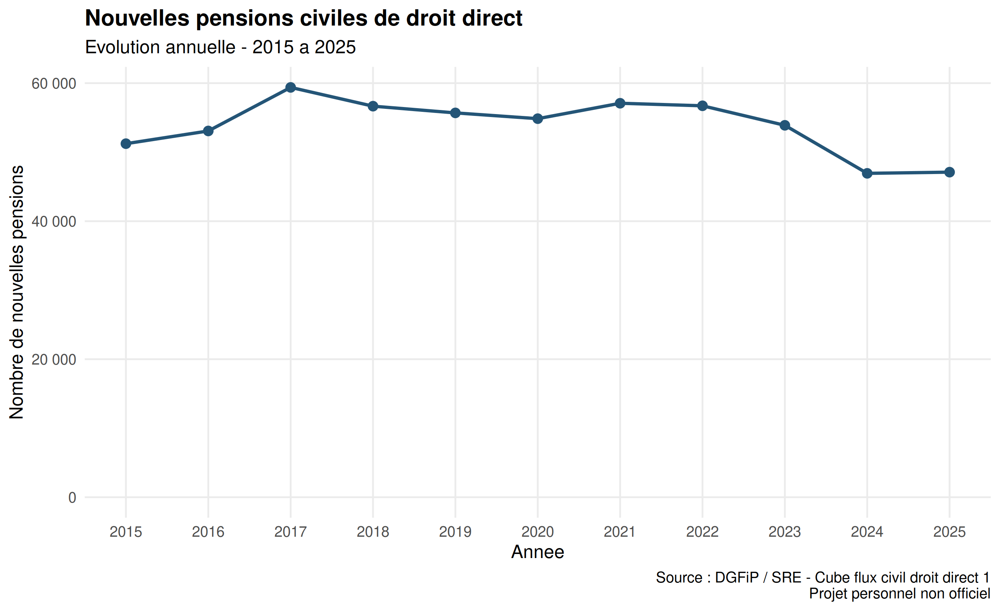
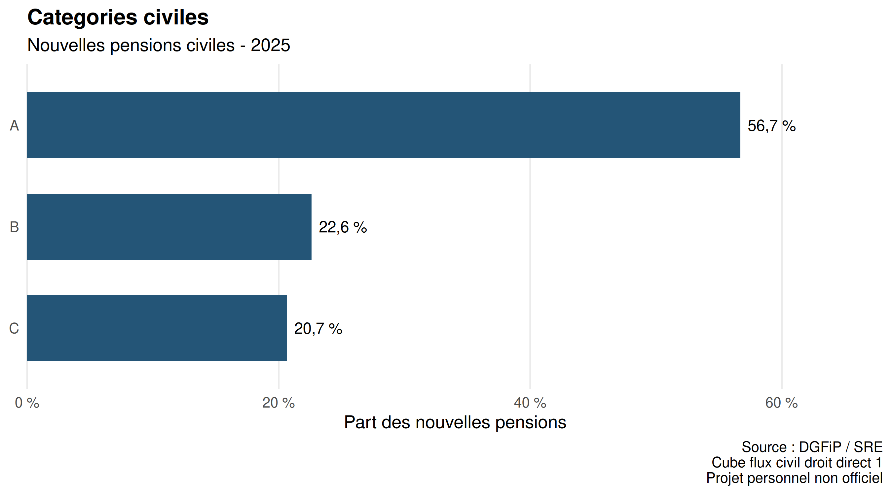
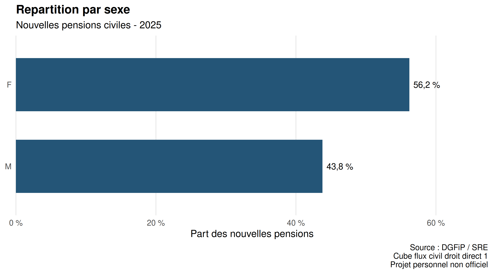
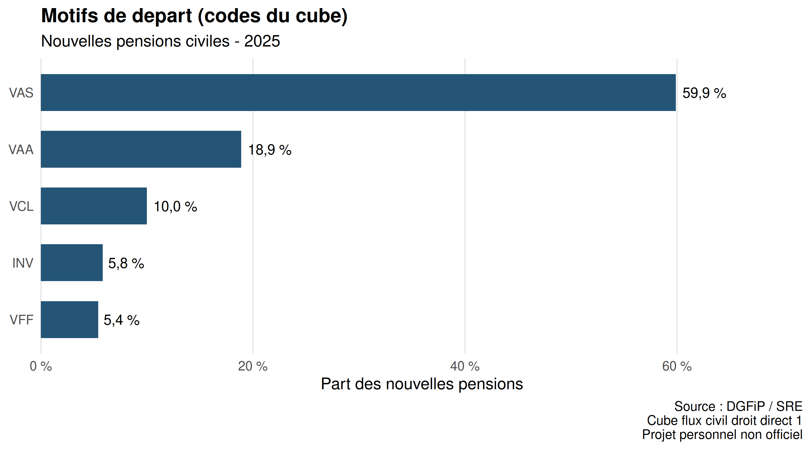
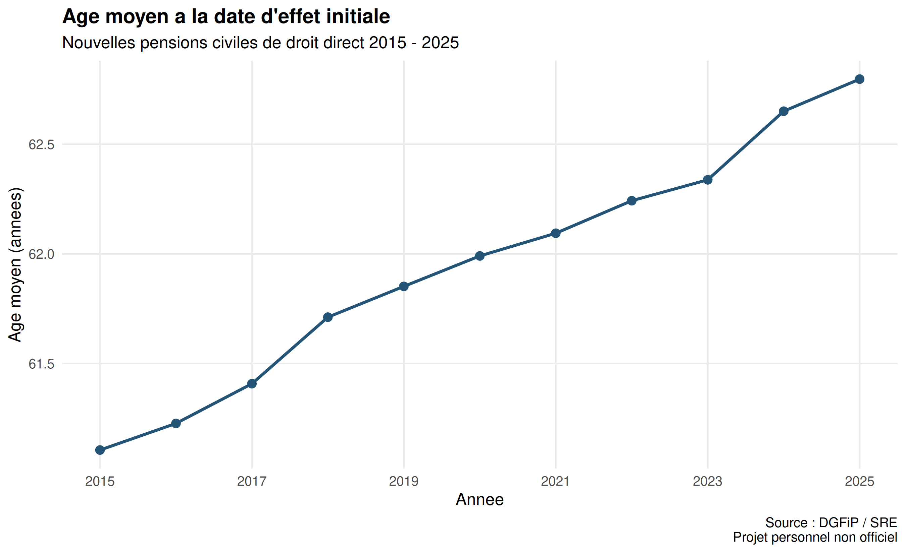
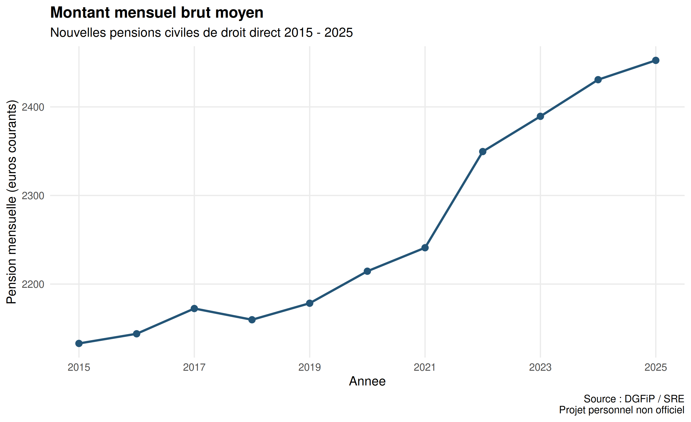

---
title: "Qualité et analyse des pensions civiles de l'État"
subtitle: "Projet personnel de production statistique avec R"
lang: fr
format:
  html:
    toc: true
    embed-resources: true
execute:
  echo: false
  warning: false
  message: false
---

```{r}
# Chargement des resultats du pipeline
racine <- if (
  file.exists("../outputs/tables/flux_annuel.csv")
) ".." else "."

lire <- function(chemin) {
  fichier <- file.path(racine, chemin)
  if (!file.exists(fichier)) {
    stop(paste("Fichier absent :", fichier))
  }
  read.csv(fichier)
}

flux <- lire("outputs/tables/flux_annuel.csv")
moyennes <- lire("outputs/tables/moyennes_annuelles.csv")
categories <- lire("outputs/tables/repartition_categories.csv")
sexes <- lire("outputs/tables/repartition_sexes.csv")
motifs <- lire("outputs/tables/repartition_motifs.csv")
audit <- lire("outputs/quality/audit_effectifs.csv")

stopifnot(
  nrow(flux) > 0,
  !anyDuplicated(flux$annee),
  setequal(flux$annee, moyennes$annee)
)

ref <- flux$nouvelles_pensions[
  match(moyennes$annee, flux$annee)
]
stopifnot(!anyNA(ref))
stopifnot(all(ref == moyennes$nouvelles_pensions))

for (tab in list(categories, sexes, motifs)) {
  tot <- aggregate(effectif ~ annee, tab, sum)
  attendu <- flux$nouvelles_pensions[
    match(tot$annee, flux$annee)
  ]
  stopifnot(
    !anyNA(attendu),
    setequal(tot$annee, flux$annee),
    all(tot$effectif == attendu)
  )
}

annee_fin <- max(flux$annee)
dernier <- subset(flux, annee == annee_fin)
moy <- subset(moyennes, annee == annee_fin)

fmt <- function(x, n = 0) {
  formatC(x, format = "f", digits = n,
          big.mark = " ", decimal.mark = ",")
}
```

# Synthèse exécutive

En `r annee_fin`, les données analysées recensent **`r fmt(dernier$nouvelles_pensions)` nouvelles pensions civiles de droit direct**.

L'effectif annuel évolue de **`r fmt(dernier$variation_pct, 2)` %** par rapport à l'année précédente.

L'âge moyen calculé atteint **`r fmt(moy$age_moyen_ans, 2)` ans** et le montant mensuel brut moyen **`r fmt(moy$pension_moyenne_euros, 2)` euros courants**.

# 1. Présentation des données

**Producteur :** DGFiP / Service des retraites de l'État.

**Source :** Cube flux civil droit direct 1.

**Période :** 2015 à 2025.

Les données décrivent des flux de nouvelles pensions et non le stock des pensions en paiement.

Ce rapport est issu d'un projet personnel non officiel.

# 2. Méthodologie

La chaîne de traitement suit les étapes suivantes :

1. Acquisition des données officielles.
2. Vérification du schéma.
3. Contrôles de qualité et journalisation.
4. Calcul des indicateurs statistiques.
5. Réconciliation des effectifs.
6. Production des graphiques et du rapport.

Les moyennes sont calculées à partir des sommes agrégées et de leurs dénominateurs, et non comme des moyennes simples entre groupes.

# 3. Bilan des contrôles qualité

```{r}
knitr::kable(
  audit,
  caption = "Bilan des controles des effectifs"
)
```

Les contrôles automatisés actuels portent principalement sur les effectifs et leurs dénominateurs.

L'absence d'anomalie détectée ne garantit pas que toutes les variables sont exemptes de problèmes.

# 4. Évolution annuelle des pensions

```{r}
knitr::kable(
  flux,
  digits = 2,
  caption = "Nouvelles pensions et variations annuelles"
)
```



# 5. Répartition par catégorie civile



# 6. Répartition par sexe



# 7. Répartition par motif de départ



Les codes de motifs sont conservés tels que présents dans la source. Leur interprétation nécessite la nomenclature officielle.

# 8. Âge moyen et pension moyenne

## Âge moyen



## Pension mensuelle moyenne



Les montants sont exprimés en euros courants, sans correction de l'inflation.

# 9. Note statistique destinée à un responsable

En `r annee_fin`, le nombre de nouvelles pensions civiles de droit direct atteint `r fmt(dernier$nouvelles_pensions)`.

La variation annuelle est de `r fmt(dernier$variation_pct, 2)` %.

L'âge moyen et la pension mensuelle brute moyenne calculés sont respectivement de `r fmt(moy$age_moyen_ans, 2)` ans et `r fmt(moy$pension_moyenne_euros, 2)` euros.

Ces résultats décrivent l'évolution des flux de pensions. Ils ne permettent pas d'établir une relation causale avec une réforme ou un changement de comportement.

# 10. Limites

Les analyses reposent sur des données agrégées.

Les évolutions sont descriptives et les montants ne sont pas corrigés de l'inflation.

L'audit qualité doit encore être étendu à l'ensemble des mesures et des nomenclatures.

# 11. Sources officielles

- [Données publiques du SRE](https://data.economie.gouv.fr/explore/dataset/cube-flux-civil-droit-direct-1/)
- [Chiffres clés des retraites de l'État](https://retraitesdeletat.gouv.fr/professionnels/les-donnees-statistiques/les-chiffres-cles-des-retraites-de-letat)

*Rapport produit dans le cadre d'un projet personnel, sans affiliation officielle avec le SRE.*
